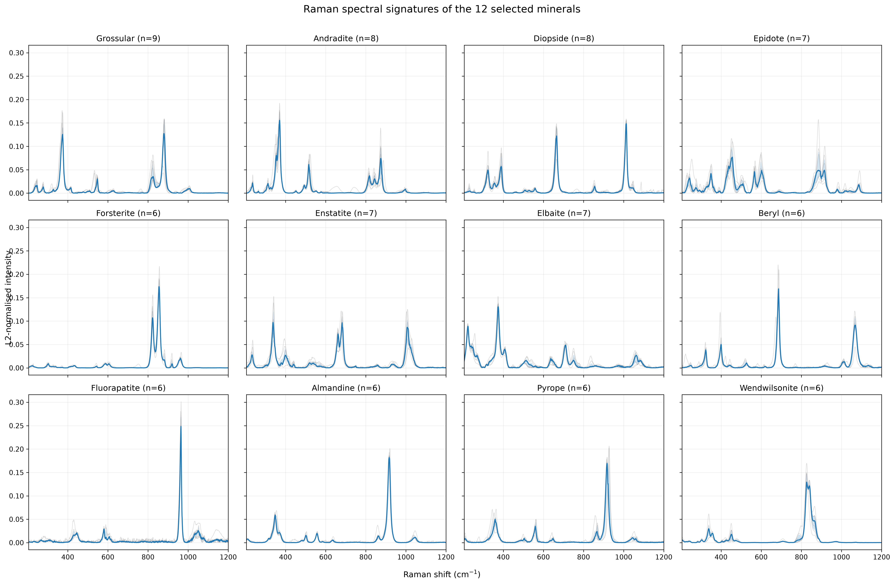
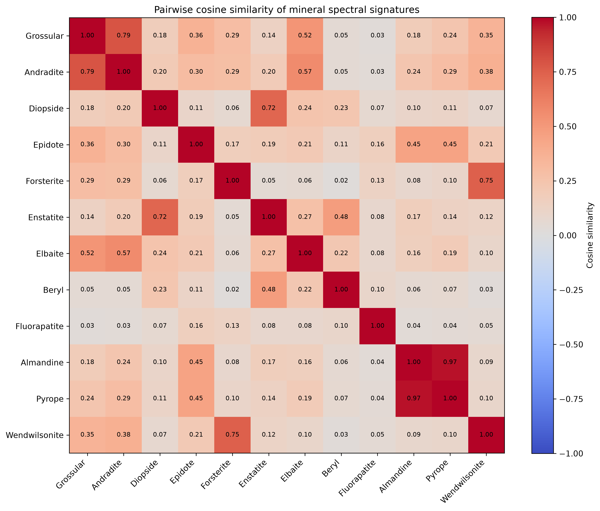
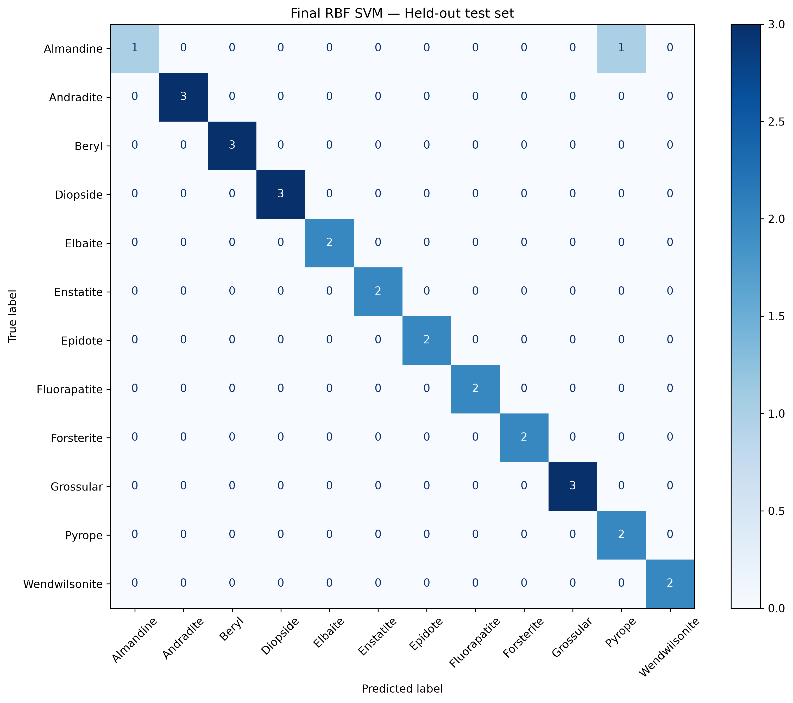
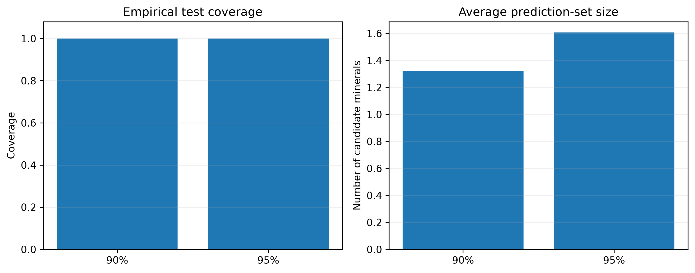

# Uncertainty-Aware Mineral Identification from Raman Spectroscopy

A reproducible machine-learning study of 12-class mineral identification from Raman spectra, combining classical classifiers with split conformal prediction.

> **Scope:** This is an independent portfolio/research project using the public RRUFF mineral database. It is a Raman-based proof of concept, not an implementation of ESA's PANGAEA system and not a validated planetary instrument pipeline. It is not affiliated with or endorsed by ESA or the RRUFF project.

## Project overview

Mineral identification from spectroscopic measurements is relevant to geological analysis and planetary exploration. A useful classifier should do more than return a single label: it should also communicate when multiple mineral identifications remain plausible.

This project investigates that problem using processed Raman spectra from the RRUFF database. It develops a reproducible data-preparation pipeline, compares classical machine-learning models with a compact 1D convolutional neural network, and applies split conformal prediction to return sets of candidate minerals with a marginal coverage target.

## Key results

The primary experiment contains **137 RRUFF sample-ID groups across 12 mineral classes**, using spectra measured at **532 nm**.

| Experiment | Result |
|---|---:|
| Best five-fold CV Macro-F1 (RBF SVM) | **0.9444 ± 0.0497** |
| Held-out test accuracy | **0.9643 (27/28)** |
| Held-out test Macro-F1 | **0.9556** |
| 90% conformal target: observed test coverage | **100% (28/28)** |
| 90% conformal target: mean prediction-set size | **1.321** |
| 90% conformal target: singleton-set rate | **67.9%** |
| 95% conformal target: observed test coverage | **100% (28/28)** |
| 95% conformal target: mean prediction-set size | **1.607** |
| 95% conformal target: singleton-set rate | **39.3%** |

The held-out test set contains only 28 observations, so these empirical test metrics are preliminary and have substantial sampling uncertainty. The observed 100% coverage is not evidence that future coverage will be exactly 100%; the conformal validity claim is marginal and depends on the relevant exchangeability assumptions.

## Dataset

- **Source:** [RRUFF Mineral Database](https://rruff.net/)
- **Collection used:** `excellent_unoriented` processed Raman spectra
- **Excitation wavelength:** 532 nm
- **Spectral interval:** 205–1200 cm⁻¹
- **Common grid:** 0.5 cm⁻¹ spacing (1,991 features per spectrum)
- **Spectral representation:** L2-normalised intensity vectors
- **Target:** mineral name from the RRUFF file metadata
- **Grouping unit:** header RRUFF sample ID
- **Identification evidence:** records whose RRUFF metadata status was categorised as diffraction-supported

The 12 classes are:

Almandine, Andradite, Beryl, Diopside, Elbaite, Enstatite, Epidote, Fluorapatite, Forsterite, Grossular, Pyrope, and Wendwilsonite.

| Mineral | RRUFF sample-ID groups |
|---|---:|
| Grossular | 15 |
| Andradite | 13 |
| Diopside | 13 |
| Epidote | 12 |
| Forsterite | 11 |
| Enstatite | 11 |
| Elbaite | 11 |
| Beryl | 11 |
| Fluorapatite | 10 |
| Almandine | 10 |
| Pyrope | 10 |
| Wendwilsonite | 10 |
| **Total** | **137** |

All measurements sharing a header RRUFF ID are assigned to the same partition. The term *sample-ID group* is used deliberately: distinct database IDs are not independently verified here as distinct physical geological specimens.

### Data access and attribution

The raw RRUFF files are **not redistributed** in this repository. Download the relevant Raman collection from the [RRUFF download page](https://rruff.net/about/download-data/) and extract it to:

```text
data/raw/rruff/excellent_unoriented/
```

The curated manifests under `data/manifests/` record the selected files and the fixed partition assignment. Raw and processed spectral data are excluded from Git by `.gitignore`.

When using RRUFF data, cite the RRUFF project and, where applicable, the original external contributor cited on the individual sample record. See the [RRUFF citation guidance](https://www.rruff.net/help/faq/).

**RRUFF project reference**

Lafuente, B., Downs, R. T., Yang, H., & Stone, N. (2015). *The power of databases: the RRUFF project*. In T. Armbruster & R. M. Danisi (Eds.), **Highlights in Mineralogical Crystallography**. W. De Gruyter, Berlin.

## Methodology

### 1. Data audit and preprocessing

1. Read RRUFF metadata from the text-file headers and use the header mineral name and RRUFF ID as the primary label and grouping fields.
2. Select 12 mineral classes with diffraction-supported identification evidence and 532 nm excitation.
3. Interpolate each spectrum onto a shared 205–1200 cm⁻¹ grid at 0.5 cm⁻¹ spacing. Extrapolation is not performed.
4. Apply L2 normalisation for the selected model pipeline. Negative values in the processed spectra are retained rather than clipped.
5. Keep the original data and the processed feature matrix separate.

### 2. Experimental split

The 137 sample-ID groups are divided using a fixed, stratified split:

| Partition | Sample-ID groups |
|---|---:|
| Training | 82 |
| Probability/calibration holdout for conformal prediction | 27 |
| Final test | 28 |

The training partition is used for five-fold `StratifiedGroupKFold` model comparison and hyperparameter selection. The conformal calibration and test partitions are not used for model selection.

### 3. Classifier comparison

The following models were compared using five-fold grouped, stratified cross-validation on the training partition:

| Model | Selected configuration | Mean CV Macro-F1 | Fold standard deviation |
|---|---|---:|---:|
| RBF SVM | `C=1000`, `gamma=0.1`, L2 normalisation | **0.9444** | 0.0497 |
| Random Forest | `max_depth=5`, `max_features=0.1`, `min_samples_leaf=1`, L2 normalisation | 0.9333 | 0.0416 |
| Linear SVM | `C=10`, maximum normalisation | 0.9222 | 0.0444 |
| Compact 1D CNN (Keras) | Exploratory architecture; not selected | 0.0131 | 0.0050 |

The compact CNN did not learn a useful 12-class decision rule in this small-data experiment: its predictions collapsed onto a small subset of classes. It is reported as a negative exploratory result rather than presented as a competitive model. The RBF SVM was selected for the final experiment.

### 4. Probability calibration and conformal prediction

The selected RBF SVM uses `C=1000`, `gamma=0.1`, and `class_weight="balanced"`. Its class probabilities are obtained using sigmoid calibration with `CalibratedClassifierCV(ensemble=False)`, with the calibration folds constructed within the training partition and grouped by RRUFF sample ID.

Split conformal prediction then uses the separate 27-observation calibration partition. The nonconformity score is:

\[
s(x_i,y_i)=1-\widehat{P}(Y=y_i\mid X=x_i).
\]

For miscoverage level \(\alpha\), the finite-sample calibration rank is:

\[
k=\left\lceil(n_{\mathrm{cal}}+1)(1-\alpha)\right\rceil,
\]

and the prediction set contains each class whose nonconformity score for the new observation is no greater than the corresponding calibration quantile.

The final test set is evaluated only after the classifier and conformal thresholds are fixed.

## Final test and conformal results

The calibrated RBF SVM classified **27 of 28** test observations correctly.

| Metric | Result |
|---|---:|
| Accuracy | 0.9643 |
| Macro-F1 | 0.9556 |

The single top-label error was an Almandine sample predicted as Pyrope. This is consistent with the exploratory spectral analysis, where the Almandine and Pyrope median profiles had high cosine similarity (0.973). The sample was nevertheless included in both the 90% and 95% conformal prediction sets after probability calibration.

| Nominal marginal coverage | Calibration threshold | Observed test coverage | Mean set size | Singleton-set rate | Empty-set rate |
|---|---:|---:|---:|---:|---:|
| 90% | 0.67566 | 100% (28/28) | 1.321 | 67.9% | 0% |
| 95% | 0.77417 | 100% (28/28) | 1.607 | 39.3% | 0% |

The larger prediction sets at the 95% target illustrate the trade-off between coverage and specificity. Per-class test supports are only two or three observations, so class-wise coverage values are descriptive and should not be interpreted as reliable class-conditional guarantees.

## Figures

The notebooks save selected figures into `reports/figures/`. The following figures are intended to be included in the repository:

### Mineral spectral signatures



### Similarity between mineral median spectra



### Held-out test confusion matrix



### Conformal prediction summary



If a figure has not been generated locally, remove its image link until the corresponding file is added. Do not commit notebook screenshots or figures that are not reproducible from the notebooks.

## Repository structure

The project is organised into three notebooks, keeping the workflow compact:

```text
notebooks/
├── 00_data_audit.ipynb          # RRUFF audit, curation, spectral EDA, preprocessing
├── 01_model_training.ipynb      # Classical ML, tuning, CNN experiment, CV diagnostics
└── 02_conformal_prediction.ipynb # Probability calibration, conformal sets, final test

src/mineral_id/
├── io.py
├── preprocessing.py
├── splits.py
└── conformal.py

tests/
├── test_io.py
├── test_preprocessing.py
├── test_splits.py
└── test_conformal.py

data/
└── manifests/                   # Curated selection and fixed split assignment

reports/
└── figures/                     # Selected, reproducible figures for this README
```

## Reproducibility

Python 3.11 or later is recommended.

### 1. Clone and create an environment

```bash
git clone https://github.com/Aimar99/conformal-mineral-identification.git
cd conformal-mineral-identification
python -m venv .venv
```

Activate the environment:

**Windows PowerShell**

```powershell
.\.venv\Scripts\Activate.ps1
```

**macOS/Linux**

```bash
source .venv/bin/activate
```

### 2. Install dependencies

For the complete project, including the optional Keras experiment:

```bash
python -m pip install --upgrade pip
python -m pip install -e ".[dev,neural]"
```

For the classical ML and notebook workflow without TensorFlow:

```bash
python -m pip install -e ".[dev]"
```

### 3. Download the dataset

Download and extract the RRUFF `excellent_unoriented` collection into `data/raw/rruff/excellent_unoriented/`. The raw files are intentionally not tracked by Git.

### 4. Run the notebooks in order

1. `00_data_audit.ipynb` — audit and curate the data, create the manifests and processed feature matrix.
2. `01_model_training.ipynb` — train and compare the classical models and run the exploratory CNN.
3. `02_conformal_prediction.ipynb` — calibrate the selected model, construct conformal prediction sets and evaluate the held-out test set.

### 5. Run the automated tests

```bash
python -m pytest -q
```

## Limitations

- **Small dataset:** the primary experiment contains 137 sample-ID groups, with only 82 used for model fitting, 27 for conformal calibration and 28 for final testing.
- **Single excitation wavelength:** the primary experiment uses 532 nm only. It does not establish robustness across laser wavelengths or instruments.
- **Selected classes:** the classifier covers 12 selected mineral classes; it is not an open-set mineral identifier and cannot reliably reject minerals outside those classes.
- **Sample-ID grouping:** partitions are grouped by the RRUFF header ID to prevent related records from crossing partitions. Distinct IDs are not independently verified here as distinct physical specimens.
- **Domain shift:** performance on this curated RRUFF subset does not establish performance on field measurements, other instruments, mixed mineral samples, or planetary rover data.
- **Conformal assumptions:** the marginal coverage interpretation relies on exchangeability between the calibration and future sample-ID units. The small, curated dataset and stratified partition design limit how broadly the empirical results should be generalised.
- **CNN:** the compact CNN was not competitive in this limited-data setting.

## Acknowledgements

This project uses the [RRUFF Mineral Database](https://rruff.net/). Please consult the RRUFF record-level citation information and cite external contributors where applicable, in addition to the RRUFF project reference above.
